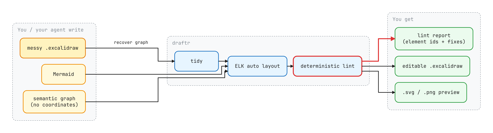
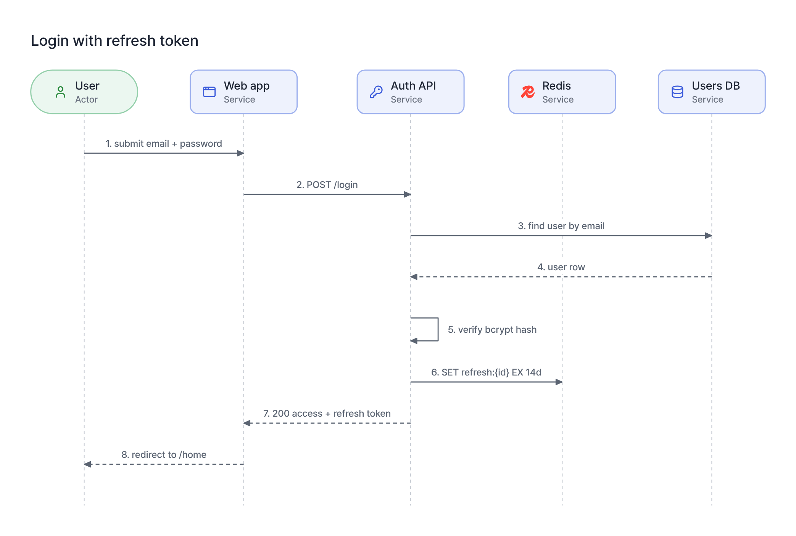
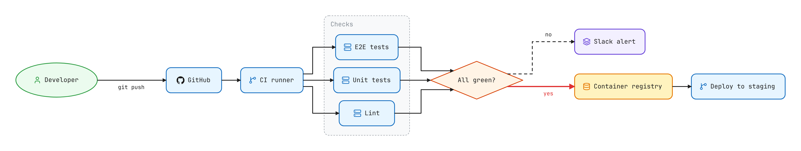
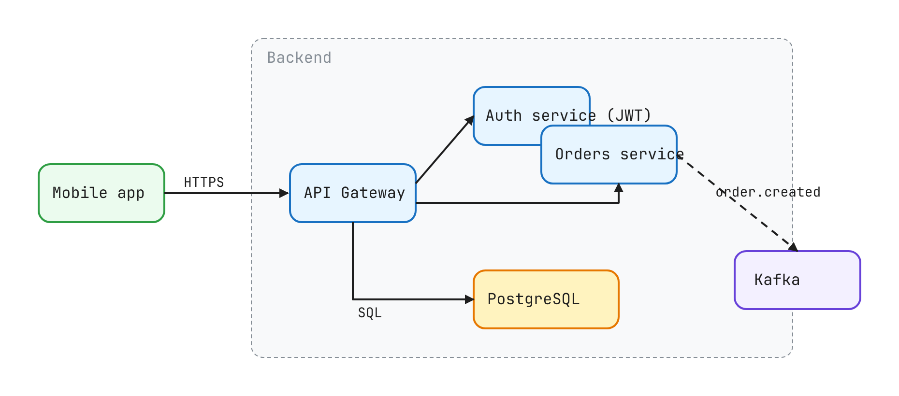
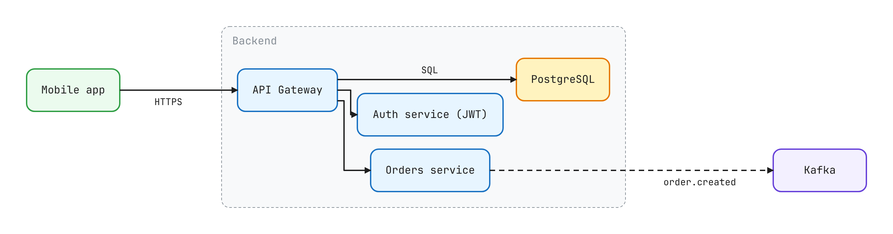
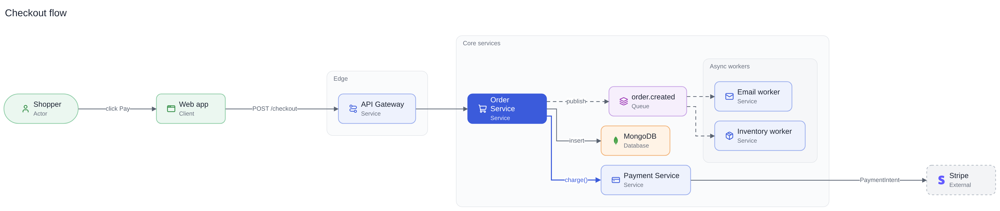
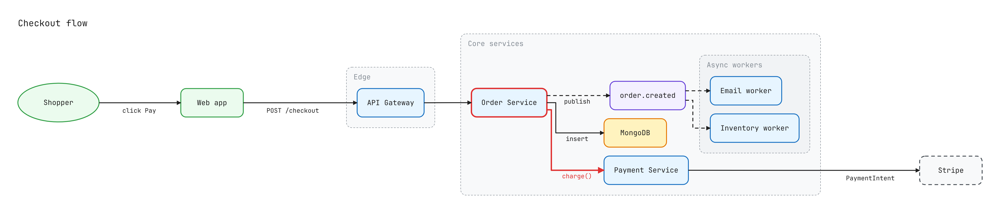

# draftr

<p align="center">
  
</p>

<p align="center"><strong>Diagrams for AI agents. The model says <em>what</em>. draftr decides <em>where</em>. A linter says what's wrong.</strong></p>

> **Side project notice** — Maintained as a side project. Best-effort response time on issues and PRs. For production use, please pin specific versions.

draftr is a CLI and an MCP server that turns a **semantic graph** (nodes, edges, groups — no coordinates) into a clean, **editable Excalidraw diagram**, an SVG and a PNG. Then it runs a **deterministic diagram linter** over the result and hands the agent a report with element ids and concrete fixes.

It also works in the other direction: point it at an existing `.excalidraw` file — hand-drawn, or hand-*written* by a model — and it will tell you exactly what's broken, or recover the graph and re-lay it out cleanly.

The image above was drawn by draftr from [`examples/draftr.json`](https://github.com/scrawl-labs/draftr/blob/main/examples/draftr.json).

## Why this exists

Ask a model for an architecture diagram and today it does one of two things.

It writes Mermaid. Fine for a README, but you can't touch it, and it looks like every other Mermaid diagram.

Or it writes Excalidraw JSON **by hand** — every `x`, `y`, `width` and arrow point — then renders a PNG and squints at it to find overlaps. That's thousands of output tokens of coordinates, two to four render-look-fix loops, and it still ships boxes whose labels spill out of them and arrows that cut through the database.

Coordinates are not the model's job. Layout is a solved problem ([ELK](https://eclipse.dev/elk/) has been doing it for a decade), and "do these two rectangles overlap?" is a question for geometry, not for a vision model.

So draftr splits the work:

| Step | Who | What |
| --- | --- | --- |
| **Describe** | the model | nodes, edges, groups, what to `highlight`. Or Mermaid. Or a sequence of messages. |
| **Lay out** | draftr | ELK layered layout, orthogonal edge routing, real nested groups, CJK-aware text sizing |
| **Emit** | draftr | an editable file with arrows **bound** to shapes (drag a box, its arrows follow), plus a docs-ready `.svg` and `.png` |
| **Check** | draftr | 12 deterministic lint rules, each finding names element ids and a fix |
| **Look** | the model | one PNG preview, to judge whether the diagram makes its point — not to hunt for overlaps |

## Install

Requires Node 20+. Wire the MCP server into your client. For Claude Code:

```bash
claude mcp add draftr --scope user -- npx -y -p @scrawl-labs/draftr -p playwright draftr-mcp
```

Or in a project-local **`.mcp.json`** (share it with your team via git):

```json
{
  "mcpServers": {
    "draftr": {
      "command": "npx",
      "args": ["-y", "-p", "@scrawl-labs/draftr", "-p", "playwright", "draftr-mcp"]
    }
  }
}
```

Playwright is only there for the PNG previews; download its browser once:

```bash
npx playwright install chromium
```

Don't want Playwright? Drop `-p playwright`. Layout, `.excalidraw`, `.svg`, lint and tidy are pure Node; the tools just say the preview is unavailable.

Restart your agent. That's it. No env vars, no API keys, no network — draftr never leaves your machine.

The CLI:

```bash
npx @scrawl-labs/draftr build diagram.json        # or install it: npm i -g @scrawl-labs/draftr playwright
```

From source:

```bash
git clone https://github.com/scrawl-labs/draftr.git
cd draftr
pnpm install && pnpm build
node dist/mcp.js        # MCP server
node dist/cli.js --help # CLI
```

## Tools

#### 🧭 `build_diagram`

Architecture and flow diagrams from a semantic graph. Writes `.excalidraw` + `.svg`, returns the lint report and a PNG preview.

> "draw how a checkout request flows through our services, highlight the payment call"

#### 🔁 `build_sequence`

Sequence diagrams from participants and ordered messages. Columns are spaced so every label fits between the lifelines it connects; self-calls draw a loop; dashed = reply.

> "draw the login sequence: user, web app, auth API, Redis, users DB"

<p align="center"></p>

#### 🧜 `build_from_mermaid`

Mermaid `flowchart` / `graph` and `sequenceDiagram` in, laid-out editable Excalidraw out. Upgrade the Mermaid already sitting in your docs.

> "turn the mermaid diagram in docs/ci.md into an excalidraw file"

<p align="center"></p>

#### 🔍 `lint_diagram`

Lint **any** `.excalidraw` file, including ones a human or another tool made.

> "lint docs/architecture.excalidraw"

```
✖ score 56/100 — 4 error(s), 2 warning(s), 0 arrow crossing(s); 6 shapes, 1 groups, 5 connectors
  E [shape-overlap] auth and orders overlap by 50×20px
      fix: move orders at least 36px away
  E [group-boundary] kafka straddles the edge of group frame
      fix: move kafka fully inside or outside frame, or resize the group
  E [text-over-shape] text auth_t ("Auth service (JWT)") spills out of auth by 71px
      fix: widen auth to ≥201px, wrap the text, or bind it as the shape's label
  W [arrow-through-text] a_orders_kafka runs through text l3 ("order.created")
      fix: move the text off a_orders_kafka
```

#### 🧹 `tidy_diagram`

Recover the graph from a messy file — shapes, labels (even ones that spill out of their box), kinds, groups, arrows and their labels — and re-lay it out. Prefer this to nudging coordinates by hand.

> "tidy docs/architecture.excalidraw"

| Before (hand-written, score 56) | After `tidy` (score 100) |
| --- | --- |
|  |  |

#### 🖼️ `render_diagram`

Render a `.excalidraw` file to PNG offline. No CDN, no browser tab.

> "show me docs/architecture.excalidraw"

#### 🏷️ `search_icons`

Find icon names for the `icon` field. Mostly you won't need it — icons are picked from labels automatically.

> "use the Kafka logo for the events node"

## Look

One theme, designed to survive the trip into every editor: a tinted box with a border in the same hue, the label with a small caption under it (`Database`, `Queue`…), an icon, and **one** solid box for the thing the diagram is about. Nothing an editor can't draw — no shadows, gradients or glows — so the file you edit looks like the picture in the README.

| | |
| --- | --- |
| **Color by kind** | services blue, data stores orange, queues violet, actors and clients green, externals grey and dashed, decisions yellow diamonds |
| **Highlight** | `highlight: true` fills the box (or colors the edge) in its kind's solid color with white text |
| **Type** | [Pretendard](https://github.com/orioncactus/pretendard) in SVG/PNG — Latin and Korean in one family. Excalidraw uses its built-in Nunito |
| **Captions** | default to the kind; set `"caption": "Postgres 16"` or `"caption": false` per node |

Every color lives in [`src/theme.ts`](https://github.com/scrawl-labs/draftr/blob/main/src/theme.ts).

### Fonts and file size

The SVG embeds only the pieces of Pretendard (Medium) that the diagram's text actually uses, so it renders the same on GitHub, in a browser or in a slide deck without fetching anything. A typical English diagram is ~40 KB, one with Korean labels ~130 KB; PNGs carry no font at all. The npm package ships the font subsets (~1.4 MB) under the SIL Open Font License, which allows bundling and embedding.

## Output formats

Pick the editor; the diagram is the same.

| `--format` / `format` | File | Open it in |
| --- | --- | --- |
| `excalidraw` (default) | `.excalidraw` | excalidraw.com, Excalidraw+, VS Code, Obsidian |
| `drawio` | `.drawio` | draw.io / diagrams.net (web, desktop), Confluence and Jira apps, VS Code |

Whatever the format, draftr also writes the `.svg` (and `.png` with Playwright). The lint report always checks the Excalidraw rendering.

In draw.io, boxes carry their icon, groups are containers (drag a group, its boxes come along), edges keep draftr's route as waypoints and their labels sit on the line. The text uses Pretendard when draw.io can load it and Helvetica otherwise.

<p align="center"><br/><sub>The checkout example as a <code>.drawio</code> file, rendered by draw.io's own viewer.</sub></p>

## Icons

Every box gets an icon, picked from its label. Write `PostgreSQL`, `orders DB (Postgres)` or just `pg` and you get the PostgreSQL elephant; write `Payment Service` and you get a card; a `queue` gets a queue.

| Set | What | Examples |
| --- | --- | --- |
| **Brands** | 240 developer logos from [Simple Icons](https://simpleicons.org) | `postgresql` `mongodb` `redis` `apachekafka` `kubernetes` `docker` `stripe` `github` `grafana` `nextdotjs` |
| **Generic** | 120+ line icons from [Lucide](https://lucide.dev), matched from English and Korean keywords | `server` `database` `layers` `mail` `credit-card` `shopping-cart` `route` `key-round` `cog` `brain` |
| **Yours** | every `.svg` in your icon folders | `acme-billing` → matches a box labelled "Acme Billing" |

How a box gets its icon, first match wins:

1. `"icon": "kafka"` on the node — any name, slug or alias. `"icon": false` for none.
2. One of **your** icons whose file name matches the label.
3. A **brand** named in the label (`Redis cache`, `k8s cluster`, `Next.js frontend`). Short, common words like `Go` or `Render` only count when they are the whole label.
4. A **generic** keyword (`payment`, `email`, `gateway`, `worker`…). Skipped for queues and databases — `order.created` is a queue, not a shopping cart.
5. The node kind's icon.

Bring your own: drop SVGs in a folder and point draftr at it. Your company's internal services get their logos in every diagram, every time.

```bash
DRAFTR_ICONS=~/icons draftr build arch.json      # or: draftr build arch.json --icons ~/icons
draftr icons postgres                             # search all three sets
```

For the MCP server, add `"env": { "DRAFTR_ICONS": "/absolute/path/to/icons" }` to its entry in `.mcp.json`.

Icons are embedded in the `.excalidraw` file and grouped with their box, so they stay put when you drag things around in Excalidraw.

## CLI

The same engine, for scripts, CI and pre-commit hooks (`npm i -g @scrawl-labs/draftr`, or prefix each command with `npx @scrawl-labs/draftr`):

```bash
draftr build  examples/checkout.json -o out/checkout   # graph → .excalidraw .svg .png + report
draftr build  examples/checkout.json --format drawio     # → .drawio for draw.io / Confluence
draftr build  examples/login.mmd                       # Mermaid works too
draftr lint   docs/architecture.excalidraw             # exit 1 on errors, --json for machines
draftr tidy   docs/architecture.excalidraw             # → architecture.tidy.excalidraw
draftr render docs/architecture.excalidraw --no-png    # offline SVG
draftr icons  kafka                                    # search icons
```

Flags: `-o <prefix>`, `-f`/`--format <name>`, `--no-png`, `--json`, `--no-icons`, `--icons <dir>`.

`lint` exits non-zero on errors, so you can keep every diagram in your repo honest in CI:

```bash
for f in docs/**/*.excalidraw; do draftr lint "$f" || exit 1; done
```

## Input formats

### Graph

```json
{
  "title": "Checkout flow",
  "direction": "RIGHT",
  "groups": [
    { "id": "core", "label": "Core services" },
    { "id": "async", "label": "Async workers", "parent": "core" }
  ],
  "nodes": [
    { "id": "order", "label": "Order Service", "kind": "service", "group": "core", "highlight": true },
    { "id": "db", "label": "orders DB", "kind": "database", "group": "core" },
    { "id": "mail", "label": "Email worker", "kind": "service", "group": "async" }
  ],
  "edges": [
    { "from": "order", "to": "db", "label": "insert" },
    { "from": "order", "to": "mail", "label": "publish", "style": "dashed" }
  ]
}
```

| Field | Values |
| --- | --- |
| `direction` | `RIGHT` (default), `DOWN`, `LEFT`, `UP` |
| `kind` | `service`, `database`, `queue`, `external`, `user`, `client`, `storage`, `decision`, `note` |
| `highlight` | on nodes and edges — the one or two things the diagram is *about* |
| `icon` | on nodes and participants: an icon name, or `false`. Omit it to let draftr pick |
| `caption` | on nodes and participants: the small second line. Defaults to the kind; `false` for none |
| `style` | edges: `solid`, `dashed` (async / optional / reply) |
| `groups[].parent` | nest groups (VPC → cluster → namespace) |

Full example: [`examples/checkout.json`](https://github.com/scrawl-labs/draftr/blob/main/examples/checkout.json)

<p align="center"></p>

### Sequence

```json
{
  "type": "sequence",
  "autonumber": true,
  "participants": [{ "id": "u", "label": "User", "kind": "user" }, { "id": "api", "label": "Auth API" }],
  "messages": [
    { "from": "u", "to": "api", "label": "POST /login" },
    { "from": "api", "to": "api", "label": "verify hash" },
    { "from": "api", "to": "u", "label": "200 + tokens", "style": "dashed" }
  ]
}
```

### Mermaid

`flowchart` / `graph` (all directions; `[]` `()` `([])` `[()]` `(())` `{}` `[//]` shapes; `-->` `---` `-.->` `==>`; `|label|` and `-- label -->`; chains; `A & B --> C`; nested `subgraph`) and `sequenceDiagram` (`participant` / `actor ... as ...`, `->>` `-->>` `->` `-->` `-x` `-)`, `autonumber`). Styling lines are ignored — draftr has its own theme.

## Lint rules

| Rule | Severity | Catches |
| --- | --- | --- |
| `shape-overlap` | error | two boxes on top of each other |
| `shape-crowded` | warning | boxes closer than 16px |
| `group-boundary` | error | a box half inside a group |
| `text-overflow` | error | a label wider or taller than its box (CJK-aware; ellipse and diamond use the inscribed area) |
| `text-over-shape` | error | free text spilling out of a box, or sitting on someone else's |
| `text-overlap` | error | two free texts on top of each other |
| `arrow-through-shape` | error | an arrow cutting through a box it doesn't connect |
| `arrow-through-text` | warning | an arrow running through a label |
| `arrow-crossing` | warning | arrows crossing each other |
| `arrow-dangling` | warning | an arrow end attached to nothing |
| `dangling-binding` / `dangling-container` | error | references to elements that don't exist |

Free text fully inside a box counts as that box's label, so diagrams that don't use Excalidraw's text binding aren't punished for it. Sequence-diagram lifelines are structure, not connectors.

## The workflows that actually help

### Case A — "Explain this service to the new hire"

```
You:    "read src/checkout and draw how a request flows through it"
Agent:  [build_diagram]  → score 100/100, preview attached
You:    "the point is the payment call, make that obvious"
Agent:  [build_diagram]  → payment node + edge highlighted
```

Two messages. No coordinates were harmed. The `.excalidraw` lands in `docs/`, editable by anyone.

### Case B — The diagram everyone's afraid to touch

```
You:    "lint docs/architecture.excalidraw"
Agent:  [lint_diagram]   → 4 errors: overlaps, a box straddling the VPC, 2 labels spilling out
You:    "fix it"
Agent:  [tidy_diagram]   → architecture.tidy.excalidraw, score 56 → 100
```

### Case C — Mermaid that outgrew Mermaid

```
You:    "convert the sequence diagram in docs/auth.md to excalidraw, highlight the token refresh"
Agent:  [build_from_mermaid] → laid out and lint-clean
Agent:  [build_sequence]     → same messages, refresh call marked highlight: true
```

## Tech stack

- TypeScript, Node ≥ 20, pnpm
- [`elkjs`](https://github.com/kieler/elkjs) — Eclipse Layout Kernel: layered layout, orthogonal routing, compound graphs
- `@modelcontextprotocol/sdk` — MCP server over stdio
- `zod` — input schemas (the same schemas the MCP tools advertise)
- `playwright` — optional, only for PNG
- Vitest — including a property-style test that lays out 40 random graphs (nested groups, CJK labels, every node kind) and requires zero lint errors

- Pretendard (SVG/PNG) and glyph metrics for Pretendard and Nunito, measured in Chromium (`scripts/build-fonts.mjs`), so boxes fit their text in every renderer

Colors live in one file: [`src/theme.ts`](https://github.com/scrawl-labs/draftr/blob/main/src/theme.ts). Swap them for your brand.

## Roadmap

- [ ] Incremental layout — keep the boxes a human moved in Excalidraw, re-lay out only the rest
- [ ] Code → graph extractors (module dependencies, HTTP routes, DB schema)
- [ ] PR bot: before/after diagram of the changed flow on every pull request
- [ ] Traces → sequence diagrams (OpenTelemetry, and [speedwagon](https://github.com/scrawl-labs/speedwagon)'s incident timelines)
- [x] draw.io output
- [ ] tldraw output
- [x] Publish to npm
- [ ] Icons from Mermaid's `@{ icon: … }` syntax

## Contributing

Issues and PRs welcome — see the templates under `.github/ISSUE_TEMPLATE/`. Diagrams that come out wrong are the most useful bug reports: attach the input. This is a side project, so response time is best-effort.

```bash
pnpm install
pnpm build && pnpm test
```

## License

MIT — see [LICENSE](https://github.com/scrawl-labs/draftr/blob/main/LICENSE). Copyright (c) 2026 Yongtaek Lee.

Bundled font: [Pretendard](https://github.com/orioncactus/pretendard) by Kil Hyung-jin, SIL Open Font License 1.1 (`fonts/pretendard/LICENSE.txt`).

Bundled icons: brand icons from [Simple Icons](https://github.com/simple-icons/simple-icons) (CC0-1.0) and generic icons from [Lucide](https://github.com/lucide-icons/lucide) (ISC). Brand names and logos are trademarks of their respective owners; their use here does not imply endorsement.
